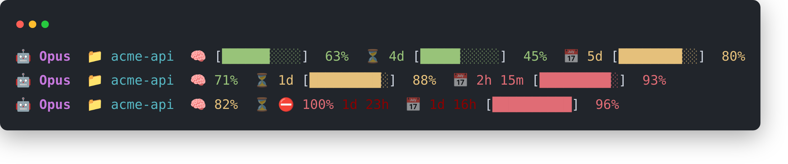

# claude-status

A fast status-line renderer for [Claude Code](https://claude.ai/code), written in Rust.

Claude Code invokes the `statusLine.command` on every refresh, piping the
status JSON to **stdin** and using **stdout** as the status line. This binary
reads that JSON and prints a line, its bars stretched to the terminal's width:

```
🤖 Opus  📁 claude-status  👤 akos  🧠 [▆▆▆▆▆▆▆▆▆▆]  63%  ⏳ 4d [▆▆▆▆▆▆▆▆▆]  45%  📅 2h [▆▆▆▆▆▆▆▆▆]  72%
```

When the terminal is too narrow for that, it drops the model; when it is
narrower still, it wraps onto two lines:

```
🤖 Opus  📁 claude-status  👤 akos  🧠 [▆▆▆▆▆▆▆▆▆▆▆▆▆▆▆▆▆▆▆▆▆▆▆▆▆▆▆▆▆▆]  63%
⏳ 4d [▆▆▆▆▆▆▆▆▆▆▆▆▆▆▆▆▆▆▆▆▆▆▆▆]  45%  📅 2h [▆▆▆▆▆▆▆▆▆▆▆▆▆▆▆▆▆▆▆▆▆▆▆]  72%
```



<sub>The same status bar at three usage levels: comfortable, tightening, and over the 5-hour limit.</sub>

- 🤖 model family · 📁 current folder · 👤 account · 🧠 context window ·
  ⏳ 5-hour limit · 📅 7-day limit (the limits omitted when Claude Code reports
  none, e.g. on an API key)
- One line as long as every bar gets at least 7 cells on it; else one line
  without the model, if that gives them 7; else two lines, the limits on the
  second.
- Each usage metric renders as **icon · reset-countdown · progress-bar · %**, and
  everything in it shares one threshold color driven by the percentage. A bar's
  filled part is in that color, its empty part grey; the cells are ¾ high (`▆`),
  so the bars of two lines don't touch.
- The bars fill the terminal width (Claude Code passes it in `COLUMNS`): the bars
  of a line share the columns its text leaves free, less 5 at the right edge,
  where Claude Code cuts the status line short with a `…`. Without a width, they
  are 10 cells, on one line.

The reset countdown and its styling escalate with usage, so a glance tells you
both how full a limit is and how long until it clears:

| Usage | Color | Countdown | Flashing | Bar |
|------:|-------|-----------|:--------:|-----|
| ≤ 75% | 🟢 green | 1 unit (`4d`) | – | ✓ |
| 76–90% | 🟡 yellow | 1 unit (`4d`) | – | ✓ |
| 91–94% | 🔴 red | 2 units (`4d 15h`) | – | ✓ |
| 95–99% | 🔴 red | 2 units | ⚡ pulses red↔dark-red | ✓ |
| ≥ 100% | 🔴 red | 2 units | ⚡ | dropped → `⛔ 100% 4d 15h` |

### The account

Several Claude Code accounts can live on one machine, each in its own config dir
(`CLAUDE_CONFIG_DIR`, `~/.claude` by default). 👤 names the one in play: the
first line of an `account-name` file in that dir —

```sh
echo work > ~/.claude/account-name
echo home > ~/.claude-home/account-name
```

— so each machine names its dirs however it likes. Without the file, the dir's
name is used: `.claude-home` → `home`, `.claude` → `default`. The config dir is
`CLAUDE_CONFIG_DIR`, or, as Claude Code leaves that unset for the default, the
one the session's transcript sits in, or else `~/.claude`.

It began life as a bash + `jq` script; at ~1 ms per invocation this Rust
rewrite is roughly 20–40× faster, and renders without any external binaries
(only the daily update below uses `curl` and `tar`).

### Updates

A prebuilt binary from the release keeps itself up to date: once a day, after
printing the status line, it starts `claude-status --update` in the background
(the status line never waits for it). That fetches the release's `.sha256` for
the platform and, when it differs from the one installed last, downloads the
archive, verifies it and renames the new binary over the old one. Sessions
running at the time pick it up on their next refresh.

It keeps its state in `$XDG_STATE_HOME/claude-status` (`~/.local/state/…`;
`%LOCALAPPDATA%\claude-status` on Windows): `last-check` (its age says when the
next update is due), `installed.sha256`, and `update.log`, the last outcome. To
update right away, run `claude-status --update`.

Only the release builds do this (the workflow compiles them with
`CLAUDE_STATUS_RELEASE` set), so a binary built from source is never overwritten
by the release.

To turn it off, set `CLAUDE_STATUS_NO_UPDATE` (to anything but `0`) for Claude
Code, e.g. in `~/.claude/settings.json`:

```json
"env": { "CLAUDE_STATUS_NO_UPDATE": "1" }
```

`claude-status --update` still updates when run by hand.

## Install

### Let Claude Code install it for you

Paste this into a fresh Claude Code session and let it do the work — it picks the
right binary for your machine, installs it, and wires up the status line:

```text
Install the claude-status status line for Claude Code from
https://github.com/axos88/claude-status. Detect my OS and CPU architecture, then
download the matching prebuilt binary from that repo's latest GitHub release
(assets are named claude-status-<target>.tar.gz, or .zip on Windows) — do not
compile from source. Extract the claude-status binary to ~/.local/bin (create it
and add it to my PATH if needed; on Windows use a suitable PATH location) and make
it executable. Then merge a statusLine entry into ~/.claude/settings.json without
disturbing my other settings:
  "statusLine": { "type": "command", "command": "<path to the binary>", "refreshInterval": 1 }
Finally, confirm it works by piping the binary a sample status JSON and showing me
the rendered line.
```

Prefer to do it yourself? Use one of the methods below.

### Download a prebuilt binary (no Rust toolchain needed)

The `latest` release always carries a prebuilt binary per platform (each with a
`.sha256` checksum alongside). Copy-paste the one line for your platform — it
downloads and installs `claude-status` to `~/.local/bin` (make sure that's on
your `PATH`):

**Linux — x86_64**
```sh
mkdir -p ~/.local/bin && curl -fsSL https://github.com/axos88/claude-status/releases/latest/download/claude-status-x86_64-unknown-linux-gnu.tar.gz | tar -xz -C ~/.local/bin claude-status
```

**Linux — ARM64**
```sh
mkdir -p ~/.local/bin && curl -fsSL https://github.com/axos88/claude-status/releases/latest/download/claude-status-aarch64-unknown-linux-gnu.tar.gz | tar -xz -C ~/.local/bin claude-status
```

**macOS — Apple Silicon**
```sh
mkdir -p ~/.local/bin && curl -fsSL https://github.com/axos88/claude-status/releases/latest/download/claude-status-aarch64-apple-darwin.tar.gz | tar -xz -C ~/.local/bin claude-status
```

**macOS — Intel**
```sh
mkdir -p ~/.local/bin && curl -fsSL https://github.com/axos88/claude-status/releases/latest/download/claude-status-x86_64-apple-darwin.tar.gz | tar -xz -C ~/.local/bin claude-status
```

**Windows — x86_64** (PowerShell)
```powershell
irm https://github.com/axos88/claude-status/releases/latest/download/claude-status-x86_64-pc-windows-msvc.zip -OutFile claude-status.zip; Expand-Archive -Force claude-status.zip .
```

On Linux, swap `-gnu` for `-musl` in the URL to get a fully static binary that
runs on any distro. Every asset has a matching `<asset>.sha256` on the release
if you want to verify the download first.

### Build from source

```sh
cargo install --path .        # installs to ~/.cargo/bin/claude-status
```

A binary built from source doesn't update itself.

### Point Claude Code at it

In `~/.claude/settings.json`, set the `command` to wherever you put the binary:

```json
"statusLine": {
  "type": "command",
  "command": "/home/you/.local/bin/claude-status",
  "refreshInterval": 1
}
```

## Testing

```sh
cargo test
```

`render()` is pure over `(JSON, now, account, width)`, so the tests in `src/lib.rs` drive it with
a fixed clock and assert exact output across every branch — the color/unit
thresholds (75, 90), the flashing zone (95, checked on both even and odd seconds
via `now`), the over-limit layout, the bars filling the width, missing metrics,
the cwd fallback, the account resolution, and malformed input degrading to
defaults.

## Releases

Every push to `main`/`master` runs [`.github/workflows/release.yml`](.github/workflows/release.yml),
which rebuilds all targets and refreshes a single rolling **`latest`** GitHub
Release with the fresh binaries (and their `sha256` checksums) — so the download
commands above always fetch the newest build. No manual tagging needed.

The [release profile](Cargo.toml) is tuned for a small binary — `opt-level="z"`,
fat LTO, a single codegen unit, and `panic="abort"` — but deliberately keeps the
symbol table (`strip="debuginfo"`) so **panic backtraces still resolve to
function names** on Linux and macOS. Full DWARF is dropped, which shrinks the
Linux x86_64 binary from ~2 MB to ~410 KB; a panic still prints its exact source
location plus a symbolicated stack (set `RUST_BACKTRACE=1`). (On Windows, symbols
live in a separate `.pdb` that the release archive doesn't ship, so backtrace
frames there show addresses only — the panic location is still printed.)
